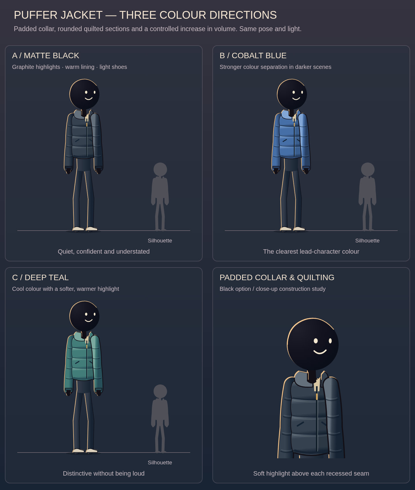

# Saved review gallery

These are small review copies, not 1080p masters. They are tracked in this repository to survive account/workspace changes and Actions-artifact expiration. On GitHub, open an MP4 and use its raw/download option if the inline viewer is unavailable; no ZIP extraction is needed.

## Start here

- [New 11s puffer/lab acting proof](review/puffer-lab-performance-11s.mp4) — walking, hesitation, console press, recoil and recovery in the projected room; owner review pending.
- [Puffer performance key poses](review/puffer-lab-performance-board.png).

- [Latest 7s room camera move](review/lab-room-depth-7s.mp4) — owner loved this background direction; stationary puffer actor.
- [11s combined performance](review/combined-performance-11s.mp4) — acting reference for the next integration; hoodie and older DepthScene, not the puffer/new room combination.
- [Puffer colour options and construction detail](review/puffer-options.png).
- [Black puffer in the sunset lab](review/black-puffer-in-lab.png).

## Earlier proofs, retained for comparison

| Clip / image | Purpose |
|---|---|
| [6s sunset lighting](review/sunset-lighting-6s.mp4) | Warm edge, cool fill, floor shadow; lighting direction liked |
| [6s character turn](review/character-turn-v5-6s.mp4) | Front/three-quarter/profile construction |
| [11s performance V3](review/performance-v3-11s.mp4) | Original notice/steps/press/recoil timing |
| [6s depth camera study](review/depth-camera-6s.mp4) | Earlier shared-camera layers/contact study |
| [9s balanced motion](review/balanced-motion-9s.mp4) | Previous body-build and motion baseline |
| [8s contact preview](review/contact-preview-8s.mp4) | Earlier reference-informed contact proof |
| [Cobalt lead-outfit comparison](review/lead-outfit-options.png) | Wardrobe exploration before the puffer request |
| [Teal/utility/waistcoat options](review/earlier-outfit-options.png) | Original wardrobe alternatives |

[Media hashes and sizes](MEDIA_MANIFEST.json) identify exact copied files. Older full-film masters are not recreated or included in this small gallery; their source/history and branch/PR pointers are preserved. Do not regenerate a long film just to populate this gallery.
